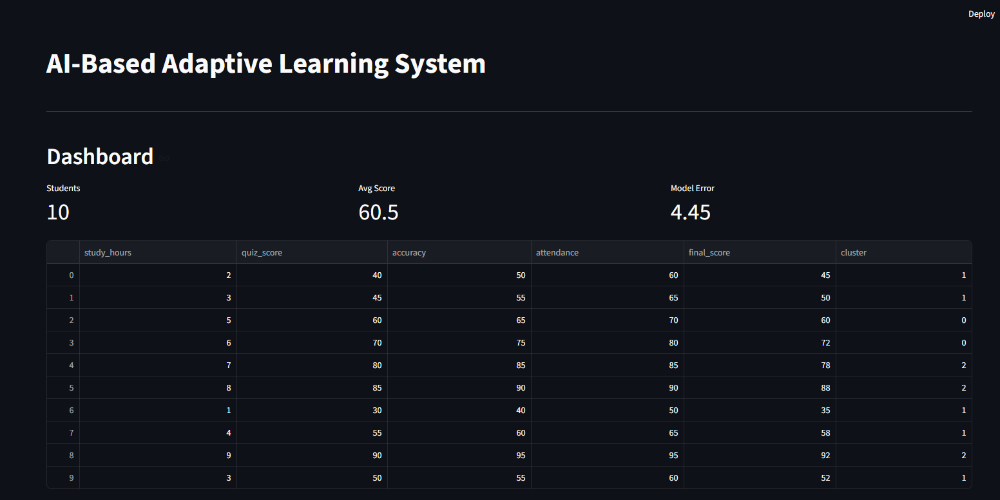
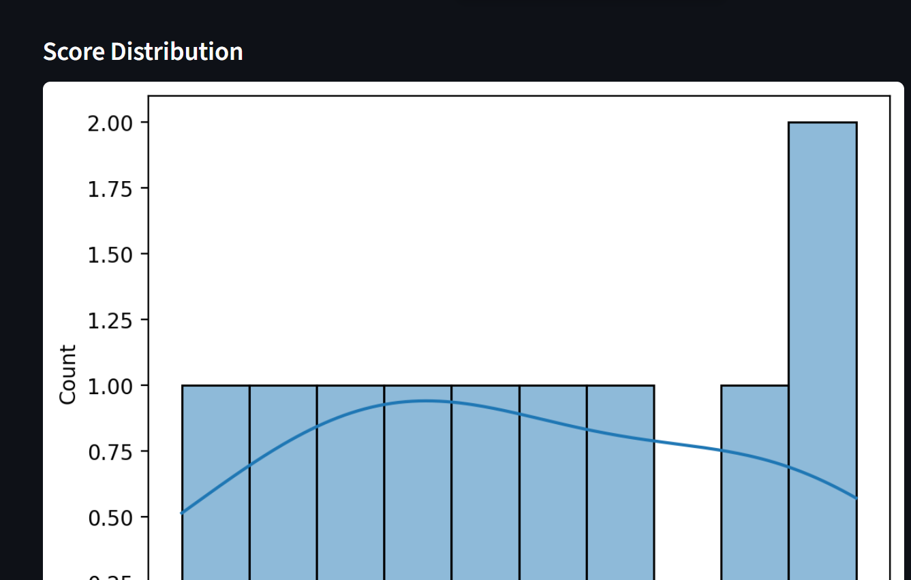

# AI Adaptive Learning System

An AI-powered learning system that understands student performance and provides personalized learning recommendations.

## Features

- Student performance analysis
- Clustering-based student grouping
- Reinforcement Learning
- Personalized learning recommendations

## Technologies Used

- Python
- Machine Learning
- Reinforcement Learning
- Streamlit
- Pandas

## Project Files

- `app.py` – Main application
- `clustering.py` – Student clustering
- `prediction.py` – Prediction module
- `rl_engine.py` – Reinforcement learning engine
- `utils.py` – Utility functions
- `data.csv` – Dataset

## Installation

Install the required packages:

```bash
pip install -r requirements.txt
```

## Run the Application

```bash
streamlit run app.py
```

## Project Goal

To improve the learning experience by analyzing student performance and providing personalized learning support.
## Screenshots

### Dashboard


### Cluster Analysis

